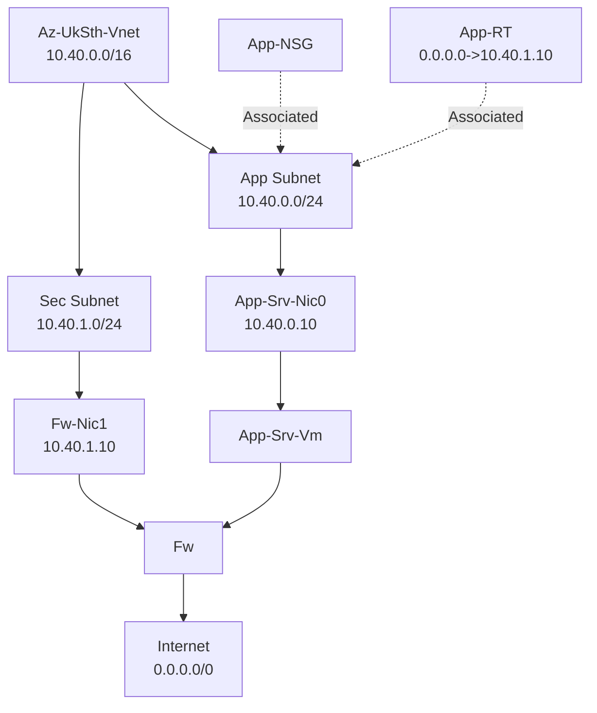

# lab1
## Azure resources Connectivity to Internet (egress)
1. Firewall (FW) is used by Associating the route table (RT) to App Subnet to let the outbound traffic from the VM1 on to any address (e.g the internet), pass first to the FW before reaching the internet
2. NSG is needed to restrict the outbound traffic since Egress is allowed by default [e.g 10.40.0.10 0.0.0.0 * Deny]

## Azure resources Connectivity from Internet (Ingress)
