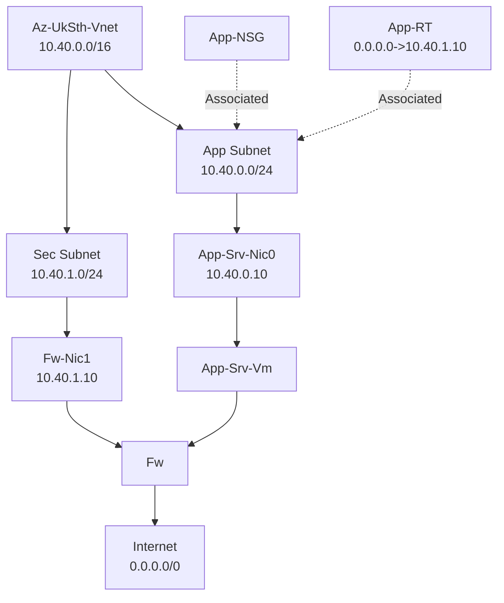

# lab1
## Azure resources Connectivity to Internet (egress)
1. RT is Associated to App Subnet for directing the outbound traffic from the VM1 first to the FW before reaching any address (e.g the internet).
2. NSG is Associated to App Subnet for restricting the outbound traffic from the VM1 since Egress is allowed by default [e.g 10.40.0.10 0.0.0.0 * Deny]

## Azure resources Connectivity from Internet (Ingress)
