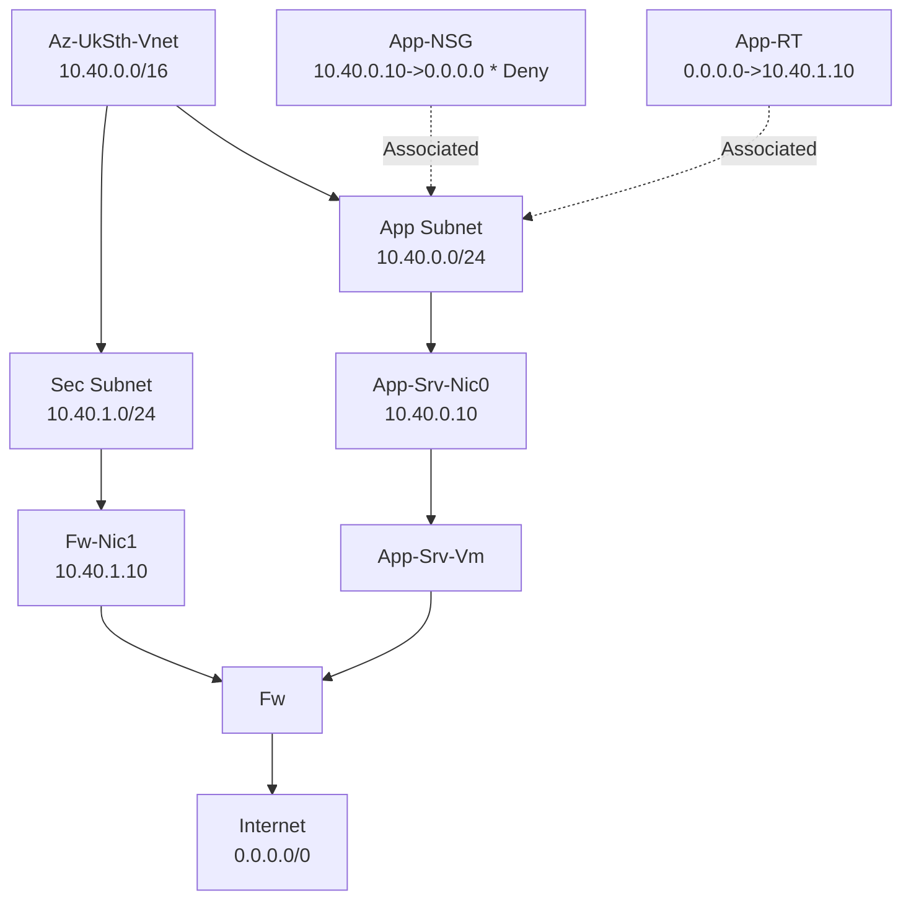

# lab2
## Azure resources Connectivity from Internet (Ingress)

On an Azure Load Balancer, load balancing rules distribute incoming traffic across a pool of multiple backend instances, whereas inbound NAT rules forward traffic directly to a specific virtual machine using port mapping. Both rule types operate at Layer 4 (TCP/UDP) and can coexist on the same load balancer.

Key Differences

Feature	Load Balancing Rules	Inbound NAT Rules
Primary Purpose	Distributes traffic across a backend pool for high availability and scale.	Forwards traffic to a specific backend VM via port translation.
Target Destination	Multiple instances inside a backend pool.	A single, specific VM (or individual VMs mapped via a port range).
Traffic Mapping	One-to-many (1 frontend IP/port to many backend IPs/ports).	One-to-one (1 frontend IP/port to 1 specific backend VM/port).
Health Probes	Required to ensure traffic only goes to healthy instances.	Not supported/not needed since traffic goes directly to a chosen VM.
Session Persistence	Configurable (None, Client IP, or Client IP and protocol).	Not applicable (connections always hit the exact same target VM).
Common Use Cases	Public web servers (HTTP/HTTPS on ports 80/443), APIs, and scalable app tiers.	Administrative access (SSH/RDP) or exposing unique ports per VM without multiple public IPs.

The `create.ps1` example uses an inbound NAT rule to forward TCP port 80 on the load balancer's public IP to port 80 on `App-Srv-Nic0`. The NIC's IP configuration is associated with that NAT rule; no backend pool, load-balancing rule, or health probe is needed for this single-VM mapping. Ensure the VM's subnet or NIC NSG allows inbound traffic to backend port 80.
